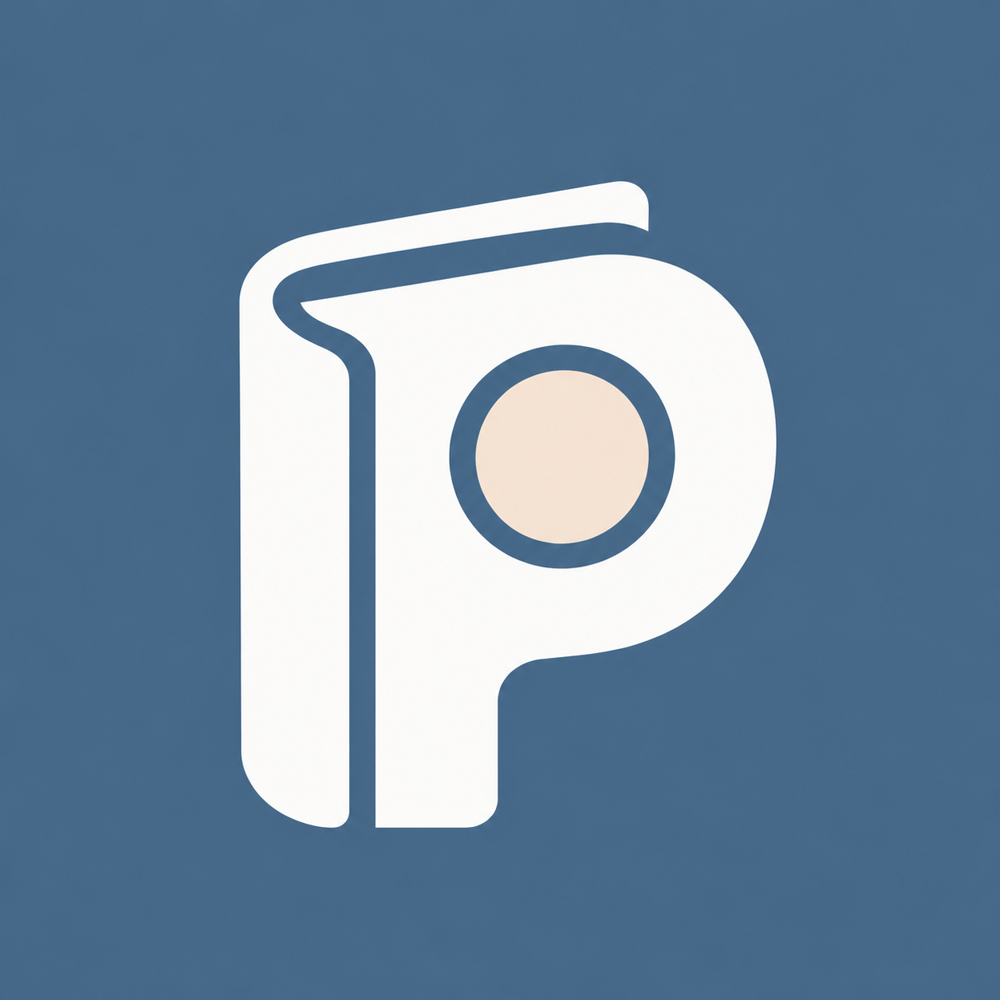

# PennyPilot 图标设计 v1



## 设计

以一枚柔和的 P 形标志融合账页与硬币。左侧书脊和翻页轮廓表达日常账本，中央暖杏色圆形呼应 Penny，P 对应 PennyPilot。延续 Flutter 主应用的雾蓝、纸白、暖杏色系。

图形采用较粗轮廓与独立圆形，在缩小后仍保留主要识别特征。此文件为图标设计源图，尚未替换 Android/iOS 启动资源；平台交付时应另行导出对应尺寸、Android 自适应图标前景/背景与单色图标，并核对系统裁切。

## 文件与生成方式

- 图像：`assets/pennypilot-icon-v1.png`
- 生成方式：内置 image_gen，先生成，再进行一次扁平化细化。
- 这是生成的 PNG 设计稿，不是可编辑矢量源文件；提示词中的色值为设计目标，像素颜色以文件实际内容为准。
- 色彩依据：`DESIGN.md`、`lib/ui/theme.dart`。

## 初始提示词

```text
Use case: logo-brand
Asset type: final mobile app icon master for PennyPilot, a calm and friendly personal daily expense ledger.
Primary request: Design one exceptional, beautifully proportioned app icon that combines a capital P, a paper ledger, and a penny into ONE simple geometric emblem. The icon must feel like a thoughtfully crafted real consumer app identity.
Scene/backdrop: solid full-bleed muted slate mist blue #4D6B85 square, edge to edge.
Subject: a bold paper-white #FCFCFA P-shaped emblem, with a softly rounded vertical book spine on the left and a generous rounded upper bowl that feels like a folded ledger cover. A single warm-apricot #F5E9DD circular penny occupies the bowl's counter, separated cleanly from the white by a narrow blue breathing space. Use a subtle geometric cut or paper fold only if it strengthens the ledger reading. The silhouette must remain extremely clean, balanced, recognizable, and custom-drawn.
Style/medium: meticulous flat vector-like brand design, smooth exact contours, generous negative space, soft but confident rounded geometry. Quiet, warm, trustworthy, personal, contemporary.
Composition/framing: square 1:1 artwork at 1024x1024 or greater; one centered emblem around 58 percent of canvas width and height; optical centering; generous safe margin so all meaningful shapes survive circular and squircle launcher crops.
Constraints: Final icon artwork only, no presentation board, no phone or surrounding UI, no external border, no rounded-corner container rendered inside the square. The blue background fills the entire canvas. Maximum three flat colors. No words, app name, captions or labels. The P is a symbol, not typeset text. Avoid generic corporate typography.
Avoid: gradient, texture, paper grain, lighting, 3D, bevel, shadows, gloss, dollar/currency signs, rising chart arrows, robot, AI sparkle, airplane, full compass, mascot, extra loose decorative objects, tiny details, thin strokes, watermarks.
```

## 细化提示词

```text
Use case: precise-object-edit.
Edit target: supplied PennyPilot app icon.
Make exactly one refinement: convert every surface to perfectly uniform flat color, eliminating ALL visible paper texture, grain, mottling, gradients, shadows, highlights, and illumination.
Preserve the exact emblem geometry, book-spine curve, P silhouette, coin circle, placement, proportions, full-bleed square background, and clear antialiased contours.
Use only these three exact solid colors: background and negative spaces #4D6B85, paper/P mark #FCFCFA, inner penny circle #F5E9DD. This should look like an impeccably clean vector export, with no material rendering or noise whatsoever. No other design changes. No text, mockups, borders, or extra objects.
```
