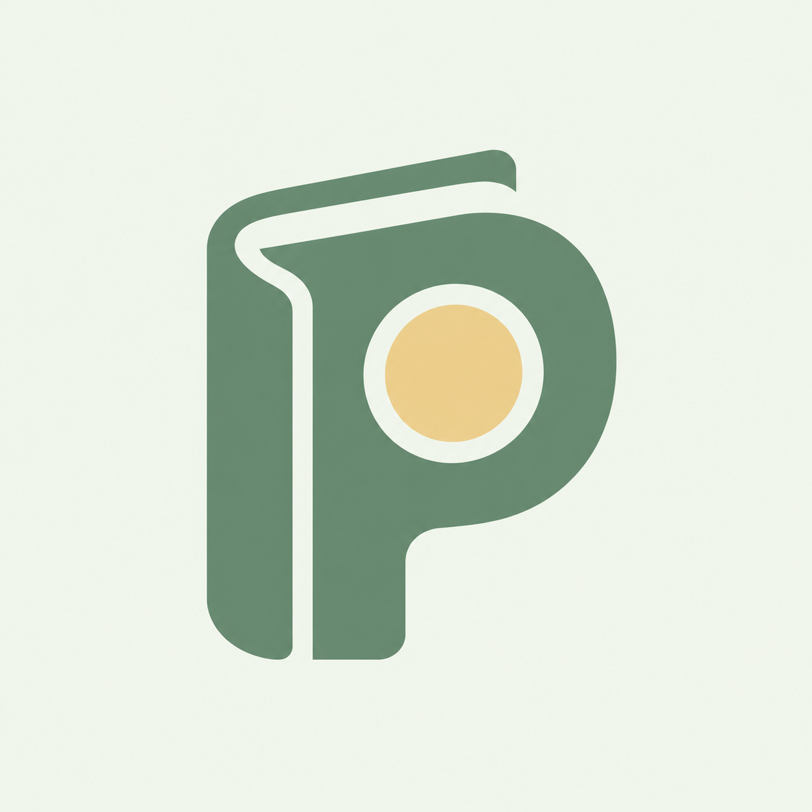

# PennyPilot 图标 v2 · 清新自然



基于用户“再清新自然一点”的反馈，保留 P、账页与硬币的融合轮廓，改用浅薄荷米白底、鼠尾草绿主体、奶油黄圆形点缀。通过明亮底色和留白减轻厚重感。

图像使用内置 imagegen 编辑 v1 生成。原版保留。当前为 PNG 设计稿，尚未替换应用启动资源；不是可编辑矢量。提示词色值为目标，文件像素以实际输出为准。

## 文件

- `assets/pennypilot-icon-v2-fresh.png`
- 1254 × 1254 像素。

## 编辑提示词

```text
Use case: logo-brand / style refinement.
Edit target: the provided PennyPilot personal expense ledger app icon.
User request: make this icon feel noticeably fresher, lighter, more natural and easygoing.
Preserve the core identity: one custom capital P silhouette integrated with a ledger/book spine and one circular penny in its bowl. Keep these as a single coherent emblem and retain the recognizable rounded ledger contour of the reference.
Change the palette and visual weight substantially:
- replace the dark blue background with a FULL-BLEED very pale warm mint/off-white #F1F6ED, calm and airy;
- change the white P/book emblem to a softly saturated medium sage green #60866C with clear contrast against the light background;
- change the central coin to a gentle sunlight butter-yellow #E6CF91, with the surrounding counter gap in the pale background color;
- redraw the P/book contour with slightly lighter visual weight, subtly softer curves, and more open negative space while remaining strong and legible at 48 px;
- make the complete emblem about 54 percent of the square width and 58 percent of the height, optically centered with generous breathing room.
Art direction: quiet spring morning, fresh everyday stationery, warm simple personal finance, friendly and understated. Natural feeling must come from color and soft geometry, not literal foliage. Perfectly flat vector-style solid fills and clean contours.
Output: a single polished square app icon master, at least 1024x1024. Show only the icon artwork, without a mockup or presentation. Background fills the whole canvas with no pre-rounded corners.
Avoid leaves, sprouts, plants, flowers, nature scenes, extra symbols, currency glyphs, thin outlines, gradients, texture, grain, shadows, bevel, 3D, lighting, glossy surfaces, typography, captions, watermarks, borders.
```
