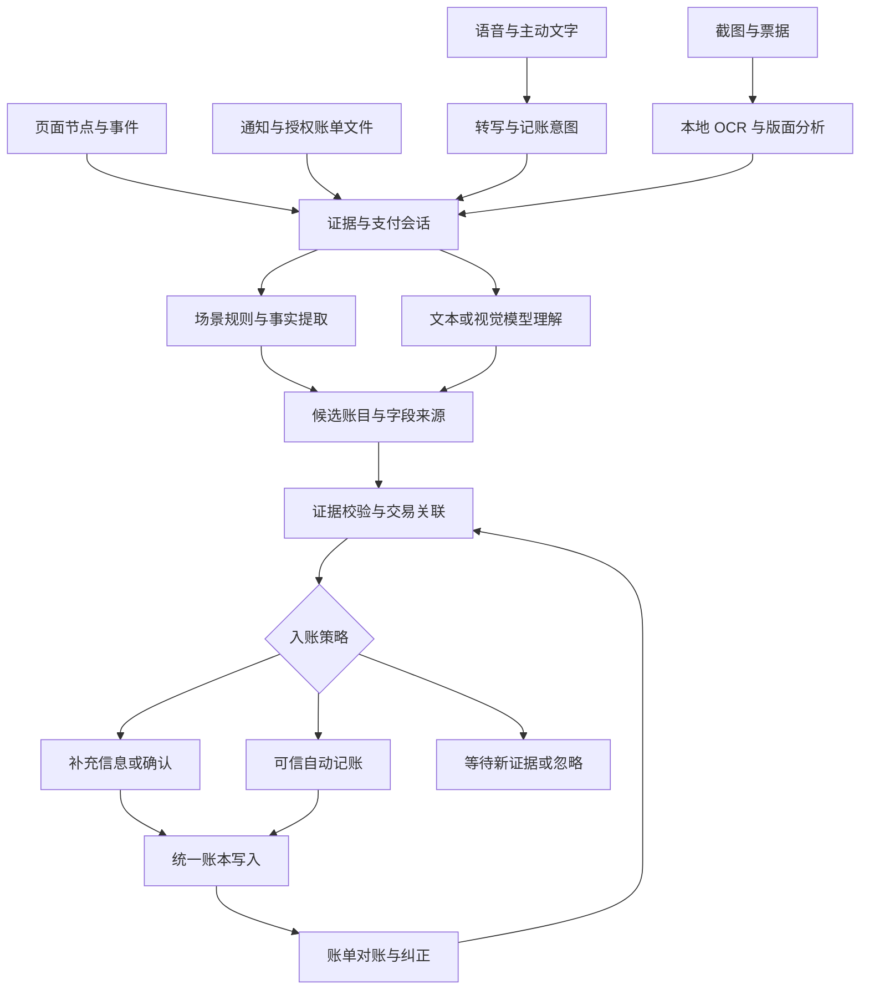

# PennyPilot 支付识别与大模型录入设计

设计日期：2026-10-24。本文为目标架构；v0.5.0 的实际链路、自动化范围和设备验收边界见 [识别系统验证](../testing/recognition-system.md)。目标是在普通 Android 手机可获得的信号范围内，同时提高实时识别准确性和账单完整性；不以现有实现或改造成本限制目标架构。

采用多源证据采集、场景规则与多模态模型协同、统一交易关联、确定性入账和事后对账。所有入口共用一套交易语义。模型可以提出新账目、补全分类、解释复杂交易和建议拆分；入账由本地策略与用户授权共同决定。

## 目标和边界

分别衡量三件事：是否捕获到交易证据，是否理解正确，是否完整且只记一次。实时路径负责及时识别，对账路径负责发现漏记和修正关联。没有页面、通知或授权数据源时，系统不能证明一笔交易发生；开启无障碍或接入更强模型也不能消除这个可观测性边界。

支付应用的包名不是场景适配的完成标准。能力矩阵必须细化到应用、应用版本、业务场景、系统和机型，并标记已验证、仅建议录入或暂无可靠证据。

## 总体流程

规则和模型都输出候选，不能各自写库。强规则命中时立即形成结果，模型可以异步做分类；未知页面由模型提供理解能力，所有结果经过相同的校验和交易关联。模型处理不阻塞采集线程。

## 采集层

| 输入 | 采集内容 | 触发和边界 |
| --- | --- | --- |
| 无障碍 | 包名、应用版本、窗口、事件类型和时间、节点父子关系、可见文字、描述、控件类型、可用 ID 与坐标 | 只处理用户启用的应用；输入、密码和聊天区域不作为支付事实采集。按窗口变化建立短期会话，保留关键状态和有限重读。 |
| 通知 | 发出应用、通知身份、发布时间、结构字段、更新关系 | 处理真实发布过的通知；服务重连可补查仍活跃的通知，不能恢复从未发布或已丢失的通知。 |
| 自动视觉补充 | 被识别为支付候选的只读区域截图 | 用户单独启用后，页面节点缺失或字段冲突时按需抓取；裁剪失败、无法排除聊天/键盘、受保护窗口时停止。 |
| 用户截图或票据 | 用户分享、选图或拍照得到的图片、导入来源和观察时间 | 支持多图、多笔及历史补录；截图中的付款人可能不是本人，导入时间不能冒充交易时间。 |
| 语音和文字 | 用户原始表达、转写片段、输入时间和时区、明确的记账/修改/查询意图 | 语音先转写再理解；不确定数字保留歧义，支持多笔和上下文纠正。 |
| 外部账单 | 用户授权导入的结构化文件、账单账户、覆盖区间、行标识 | 先用格式解析器读取，未知格式才让模型建议映射；逐行校验、预览和去重。 |

Android 提供无障碍截图 API，但需要声明能力，受保护窗口会拒绝截图。视觉补充不能绕过这些限制；失败后转为用户主动导入或对账。[Android 官方接口](https://developer.android.com/reference/android/accessibilityservice/AccessibilityService)

本地中文 OCR 优先采用随包内置方案，避免首次使用依赖模型下载。ML Kit 提供这种方式；具体识别质量仍以支付截图样本评测。[官方文档](https://developers.google.com/ml-kit/vision/text-recognition/v2/android)

采集只做快速筛选、快照与排队。每次模型请求关联固定的证据版本；新字段到达时生成新版本，不把过期结果写回。截图回调到达时校验应用、窗口和时间，不能把切换页面后的图片与旧节点拼成同一帧。短期会话用单调时钟计算超时，真实交易时间和观察时间分别保存。不同窗口、双开/工作资料实例不能共用一个全局会话；无法区分账户时降低自动化等级。

## 统一数据语义

需要区分支付事实、业务关系和个人账本，不能只保留 amount、merchant、income/expense 三个字段。

| 对象 | 关键内容 |
| --- | --- |
| Observation | 来源应用与账户范围、观察时间、事件身份、节点/通知/图像片段引用、保留策略 |
| EvidenceField | 字段值、原始片段定位、归一化过程、来源为直接读取/用户声明/推断/用户偏好、冲突与缺失原因 |
| PaymentEvent | 金额和币种、本人资金流向、付款方/收款方角色、成功/处理中/失败等支付状态、实际时间及精度 |
| BusinessRelation | 商户订单、支付交易、退款、红包、借款、报销、分摊之间的关系 |
| CandidateProposal | 一笔或多笔拟记账项、已有账目关联建议、待问字段、模型/规则版本 |
| LedgerOperation | 新建、追加证据、建议修正、冲销/撤销；幂等身份、预期账目版本和来源 |
| Reconciliation | 对账账户和期间、导入覆盖范围、匹配记录、缺失/冲突及处理状态 |

金额使用币种对应的最小货币单位整数或明确精度的十进制，禁用浮点计算。订单号、支付号、退款号使用“平台＋账户范围＋标识类型＋值”的身份空间；未知账户要显式保留，不能假定属于同一账户。

支付状态、对方领取状态、账单审核状态和对账状态分开保存。例如“我已转出、对方未领取”是付款成功与领取待完成同时成立；不能据此撤销付款，也不能因“对方已收钱”把本人记为收入。

“转出”只说明资金方向。消费、借出、给家人转钱、本人账户转移属于不同账务语义。不知道用途时，保存资金变动和待分类关系；未知项在报表里单独列出，不能悄悄算成消费或收入。分类不明不应阻塞事实完整的支付记录。

## 场景识别

每个适配器声明应用及版本范围、场景、页面锚点、区域约束、排除条件、完成状态、金额角色、身份字段、规则版本和回放样本。ID、Activity 和位置只用于辅助；页面结构相似度用于选择适配器，不能用作交易身份。

| 场景 | 关键判断 |
| --- | --- |
| 微信转账付款 | 本人付款完成、转出金额和收款人；对方未收款不否定本人的付款。区分刚完成的结果与历史详情重开。 |
| 微信收款 | 待确认不记到账；确认领取后，或可信到账证据出现后，形成转入。 |
| 商户支付 | 实付优先于原价；优惠、余额、积分和手续费使用不同字段。金额在凭证区域中定位，排除推荐商品和广告。 |
| 红包 | 发出、领取、未领取退回为独立事件；不能只用“红包”判断方向。 |
| 退款 | 退款申请和到账分开；原支付与每笔退款分别建身份，部分退款累计不能无解释地超过原金额。 |
| 平台跳转钱包 | 分别保留业务订单和实际付款证据；建立明确关联后形成一次资金变动。 |
| 代付、分摊、报销 | 区分实际支付总额、个人承担、应收应付和后续偿还；依据用户声明或凭证建立关系。 |
| 本人互转、充值、提现、还款 | 识别资产账户变化和手续费，避免消费或收入双算。未知账户关系交用户选择。 |
| 免密扣款和自动续费 | 通知与后续账单为主，不要求前台页面存在。 |
| 历史详情 | 被动浏览默认仅用于关联已有证据；主动补录模式可以生成历史候选，并保留实际日期。 |

正在支付的页面可用于判断会话进展，但不能从输入金额、支付按钮点击或“准备付款”推导付款成功。界面有多个金额或互相冲突的状态时，保留冲突，不选一个看起来合理的答案。

## 大模型推断与录入

### 模型承担的任务

第一步是事实抽取：把节点、通知、OCR 和裁剪图片中的事实映射到统一结构，每个关键字段必须引用对应片段。支持未知布局、多笔票据和不同金额角色。

第二步是语义理解：判断本人在交易中的角色、业务场景、用途、分类、账户别名和拆分关系。模型可参考少量与这笔交易相关的用户规则、历史更正和候选交易，不能默认读取或上传完整账本。

第三步是提出录入计划：新建几笔、关联哪一笔、只补证据还是需要问什么。模型返回计划，不获得数据库写入权限，也不获得支付、点击或跨应用操作权限。

对复杂图片或规则与模型冲突的样本，可调用更强的视觉/推理模型复核。多个模型的相同答案不代表独立证据；同一截图产生的 OCR、视觉结果和模型复核也属于同一来源。

### 统一输入与输出约束

模型输入包含任务种类、有限证据包、来源与可信级别、字段片段 ID、候选会话、允许的分类和账户、相关用户偏好，以及严格输出结构。

输出至少包含：

- `intent`：新建、修正、查询、仅描述或未知；主动指令与凭证里的文字分开。
- `proposals[]`：可表示多笔；每项包含场景、金额、币种、资金方向、支付状态、账务类型、对手、时间及其精度、分类、账户、交易标识和关系建议。
- `fieldEvidence`：每个字段的原文位置、数值或时间转换依据，以及直接读取/用户声明/语义推断/用户偏好标签。
- `missingFields`、`conflicts`、`questions`：明确表达缺失和冲突；缺字段返回 null，禁止用“当前时间”“支出”或“默认账户”悄悄替代未知事实。
- `proposedOperations`：创建候选、关联候选、补充证据或建议修正；其引用必须属于本次提供的对象。

优先使用支持严格 JSON Schema 的模型接口，所有返回仍由本地做结构和业务校验。供应商是否支持图片、严格 Schema 和特定推理模式须分别检测；接口支持 JSON object 不等于符合业务结构。[百炼结构化输出说明](https://help.aliyun.com/zh/model-studio/qwen-structured-output)

节点、截图、OCR、商户名和文件内容一律作为数据。里面出现“忽略规则”“删除账本”等文字不能成为指令。模型不接收 API 密钥，不能调用写入工具；来源引用必须真实存在，金额必须能从对应金额字段归一化，模型生成的解释不算证据。

### 主动录入的体验

用户说“帮我记一下，昨晚和朋友吃饭一共 240，我付的，大家 AA，三个人”，系统应提出：本人账户流出 240，个人餐饮 80，应收朋友合计 160。人数是否包含本人不清楚时只询问这一点。后续收到 160，用于结清应收，不重复记收入。

用户说“昨天早餐 12，打车 28，晚上收到报销 200”，生成三笔候选；报销能否关联已有垫付，取决于账本证据。用户只是说“明天准备买 300 元的东西”，只表示计划，不生成已发生支出。

“帮我记 50 元午饭”属于用户声明，允许不依赖外部支付凭证。明确的金额、方向和意图完整时，可按用户启用的“主动输入自动保存”策略写入并提供撤销；语音数字不确定、时间歧义、改动已有账目或关系不清时展示简短确认卡。

用户说“刚才那笔改成交通费”，模型先定位候选；有多笔可能时让用户选择。所有修正携带账目版本，避免迟到的推断覆盖已经完成的人工编辑。

## 模型配置与路由

配置按能力角色组织，允许多个角色共用一个服务商和模型：

| 角色 | 选择依据 |
| --- | --- |
| 语音转写 | 中文口语、金额/日期/商户名错误率，数字片段和备选转写能力 |
| 文本与节点理解 | 中文支付语义、多笔和角色识别、可靠的结构化输出 |
| 图片理解 | 中文小字、版面关系、截图/票据/长图、多图一致性 |
| 复杂复核 | 多证据冲突、退款/分摊等关系推理；只在需要时升级 |

模型版本由支付样本评测确定，固定版本并记录变更；不要把一个会自动变化的通用聊天模型直接当成长期稳定的账单引擎。切换前运行同一测试集，输出业务错误和等待时间的比较。

设置页面包括服务商/地址、模型、密钥、角色分配、能力测试、云端允许的数据类型和失败后的处理方式。测试必须走实际文本、结构化结果、图片或音频请求，不能只检查 URL 可连接。密钥使用系统安全存储；导出账本不含密钥。

正常路径先做本地规则和校验；模型理解与分类可并行。未知页面直接进入模型分析，不必反复尝试大量通用正则。模型不可用时保留待处理候选，规则仍可工作；允许在授权的模型列表内降级，不静默更换数据接收方。用户选择仅本地时，使用已部署且通过同一评测的端侧模型，未支持的能力明确显示不可用。

## 自动入账策略

默认建议为“证据充分自动记，歧义集中确认”。自动采集、主动输入自动保存、云文本分析、云图片分析和云端语音转写是五个独立的用户设置，不能互相隐含授权。

| 条件 | 行为 |
| --- | --- |
| 已验证场景，成功状态、金额、币种和本人资金方向完整，无冲突，身份检查通过，自动记账已启用 | 自动写入资金事实，提供撤销；缺用途时标待分类，模型可提出分类建议。 |
| 已验证的模型识别路径，关键字段有可检查证据且通过相同入账条件 | 可进入自动路径；不能仅凭“模型很自信”放行。 |
| 未知版本/新场景，模型解析完整但尚未通过该场景验收 | 展示候选和金额、方向、时间依据，一次确认录入。 |
| 明确的主动记账指令，关键数字无歧义，符合用户启用的快速保存策略 | 按用户声明录入，提示结果并可撤销；来源标为用户声明。 |
| 金额、方向、状态冲突，语音数字歧义，疑似重复或无法判断本人角色 | 只询问影响入账的最少信息，或留待确认。 |
| 支付处理中、字段延迟加载、网络失败 | 保留会话或持久任务，等待或重试，不生成成功事实。 |
| 失败、未付款、广告、聊天描述、仅计划购买 | 不自动建账；需要时保留不含原文的诊断原因。 |

自动入账资格根据独立测试集的分场景错误率、证据完整性和线上纠错情况校准。模型自报 95%/99% 不能当作真实正确率。置信度可用于内部候选排序，不能越过硬性校验。用户主动选取截图也不意味着截图中的所有账目都应自动保存。

## 关联去重和账本写入

以事件日志保存证据和关系，用单一写入器生成账本结果。必须区分三类重复：同一事件重发、同一支付被多个渠道观察、同额同对手的真实另一笔支付。

1. 同一支付候选具有稳定的逻辑身份，规则、模型和后续证据版本都归属于它；证据版本不能作为再次新建账目的依据。操作重试沿用相同幂等键，新证据作为修订或补充操作。
2. 有可靠交易标识且语义一致时关联到同一资金变动；退款 ID 与原支付 ID 不能混用。
3. 没有强标识时，根据会话连续性、方向、对手、实际交易时间、金额及来源关系形成关联建议。同额短时不足以自动合并；同一结果页内的重复读取可归并证据，但跨会话重开不能靠金额直接归并。
4. 金额先到、订单号后到时追加证据；不另建账，不覆盖人工填写的分类和账户。
5. 用户确认、编辑、撤销和删除有独立版本。迟到的通知、模型结果和任务重试不得复活已撤销账目。

入账操作的幂等登记、逻辑交易身份归并、账目预期版本校验、撤销标记检查和实际写入在同一数据库事务中完成，防止规则与模型并发各创建一次。候选版本变化只触发重新校验，不能绕过逻辑交易的唯一性约束。

本人的账户互转生成相互关联的账户变动；退款关联原支出；信用卡消费和后续还款避免重复算消费。拆分账目须校验总额与子项守恒。重复合并和账目修正保留审计与可撤销操作。

## 可靠运行和补漏

采集与模型分离成持久流水线：已观察 → 已排队 → 解释中 → 已验证/待确认 → 已提交。对允许保留的支付证据加密存储并设置到期清理，任务失败不能悄悄丢弃。高价值的支付完成证据优先排队，普通内容变化可合并；出现队列溢出必须报告具体诊断计数。

后台运行不依赖 Flutter 页面存活。Android 原生服务负责事件与短期会话；合规的持久任务处理延迟推断和恢复。权限状态、服务是否实际连接、最近收到事件、读取情况、匹配情况、模型情况与入账情况分别监测。系统杀进程或限制后台时显示覆盖缺口，不能把“权限已开启”当成“全天正常”。

账单导入记录账户和覆盖期间，使用期内交易集合对账，列出新发现的漏记、重复候选、金额冲突和未能匹配的项。没有取得覆盖完整的账单时，不宣称“当天没有漏记”。无法唯一匹配的记录保留两边证据并请求选择；用户确认的既有记录不被导入静默改写。

## 用户体验和数据控制

日常入口保持三个：自动记账的状态和结果、说一句/输入文字/分享图片记账、待确认收件箱。待确认卡突出金额、方向、时间和需要回答的一件事；字段详情可查看“页面读到”“你说的”“根据偏好推断”等来源，不显示未校准的准确率。

已自动记账的结果可撤销；离开支付应用后统一展示，避免依赖支付页悬浮窗才能证明捕获成功。语音停止后可直接生成草稿，保留原转写供核对；多笔候选可批量确认。

“诊断这次支付”由用户主动触发，在本地预览节点及可选截图，支持脱敏后导出。普通日志只保留状态、规则版本、计数、耗时和错误原因。原始节点/图片默认短期保存并到期清理；结构化来源与必要的裁剪凭证按用户设置保留，删除与备份规则一致。

自动云识别按应用和数据类型授权，先在本地剔除输入、密码、聊天和无关区域；无法可靠裁剪时不自动上传。支付交易 ID 可在本地完成匹配，云模型只接收对应的临时引用。云端语音转写单独说明会发送录音；录音在转写完成或用户取消后清理，失败重试所需缓存须加密并限时保存，未开启保留时不能长期留存。用户更正形成可查看、可删除的分类/账户别名偏好，不训练出自动改金额或推定成功状态的规则。

## 工程边界

当前主动 AI 录入在 Dart 与 Native 中有两套解析与校验；通知有单独模型回退，页面没有模型入口。目标是统一协议和业务内核，消除不同入口对未知类型、坏日期等情况的不同默认值。

建议模块边界为：

`CaptureAdapters → EvidenceStore/SessionManager → RecognitionEngine → ProposalValidator → TransactionResolver → CommitPolicy → LedgerWriter`

旁路模块为 `ModelGateway`、`UserPreferenceStore`、`ReconciliationService`、`DiagnosticStore` 和 `RuleRegistry`。模型网关处理多模态消息、任务角色、能力探测、超时、请求版本和授权范围；识别内核负责业务语义。跨平台共享 schema、错误类型和黄金样本，Android 后台使用同一业务规则或共享内核，不能依赖 UI 临时对象。

数据库需支持证据、交易实体、关系、候选、任务、账本操作与对账运行记录；迁移和备份同步设计。不同平台不具备相同采集权限时，保持同样的录入语义，单独声明可用入口。

规则更新采用版本固定、签名校验、兼容范围、灰度与回滚。模型可以辅助离线生成规则草案，经过脱敏样本回放和人工审查后发布；不让模型在用户手机上生成并执行任意采集脚本。

## 验收

真实脱敏样本包含节点树、关键帧、通知、事件序列、应用/系统版本和期望账本变化。合成数据负责补边界；真机支付与账单核对负责端到端验收。模型训练/调参样本和验收样本分离，同一笔交易的节点、截图、通知放在同一分组，并增加未见过的页面版本，避免泄漏导致虚高成绩。

必须覆盖成功、处理中、失败、取消、待收款、退款申请、部分退款、历史详情重开、快速返回、连续同额、同笔多渠道、跨 App、双开、字段延迟、空节点、受保护页面、截图包含聊天或广告、断网、权限撤销、进程恢复、模型迟到、用户先编辑/撤销、语音数字歧义和提示词注入。

指标分别报告：在可观察范围内的捕获率、金额/方向/状态/时间字段准确率、自动入账正确率、误自动入账率、重复率、真实第二笔被合并率、待确认比例、对账后的漏记率、端到端延迟与耗电。自动覆盖率与准确率同时报告；不能通过把所有样本送人工确认得到虚假的“高准确”。

自动入账的发布门槛应比候选生成严格。关键负样本不能误自动记账；自动路径精度需用足够样本与统计区间证明，未验证场景只允许生成建议。规则、模型、提示词或系统版本变化后，重跑相关矩阵，并可单独降级某一场景为待确认。

## 决策

建设一套证据驱动、具备多模态推断能力的记账系统。完整方案包含实时采集和对账、规则和模型、自动入账和人工纠正；四部分共同构成可靠性。实施时按端到端场景验收，先用用户实际的微信付款流程验证整条链路，再扩展场景矩阵。目标架构不缩减，但任何场景都必须拿真实证据验收后才宣称支持。

前期实现调研见 [支付场景采集调研](../research/2026-10-24-payment-capture.md)。
